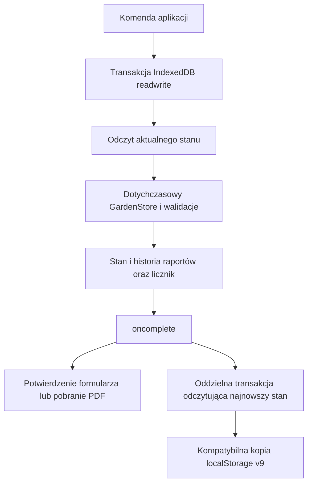

# Atomowy zapis raportów i danych firmy

Podstawa: main `5b06761`, niezależnie od PR #13. Model biznesowy i kopie pozostają
w formacie **v9**. Nie zmieniono reguł rozliczeń, numerowania `BO/rok/000001`,
płatności, stopera ani harmonogramów.

## Przyczyna błędu

Web Locks szeregował wywołania, lecz druga karta mogła odczytać starszy snapshot
localStorage. Oba podglądy miały licznik 0. Każda komenda poprawnie walidowała
swój nieaktualny odczyt, po czym zapisywała cały JSON z licznikiem 1 i jednym
raportem. Powstawały dwa pliki z tym samym numerem, a ostatni zapis usuwał wpis
pierwszego raportu. Problem odtworzono na main, bez kontrolera nawigacji PR #13.
Kolejka w jednym dokumencie ani opóźnienie po Web Lock nie zapewniają transakcji.

## Najmniejsza bezpieczna zmiana

Nowe IndexedDB `garden-manager-state` ma magazyn `state`, rekord `current`
z `{revision, data}` oraz rekord `migration-source` z oryginalnymi bajtami
localStorage sprzed przejścia. `data` jest dotychczasowym obiektem v9. Wewnętrzna
rewizja służy powiadomieniom między kartami i nie trafia do JSON/ZIP.

Każda komenda aplikacji, także edycja klienta, wizyta, płatność, zdjęcia i import,
przechodzi przez tę samą transakcję `readwrite` na tym samym magazynie. Komenda
synchronicznego GardenStore wykonuje się na świeżym stanie w pamięci wewnątrz
callbacku transakcji. Dotychczasowe walidacje, CAS i obliczenia pozostają wspólne.
Odczyt, ponowne wyznaczenie numeru, walidacja podglądu, zmiana licznika i dopisanie
historii są zatwierdzane jednym `put`, a wynik wraca dopiero po `oncomplete`.
Transakcje są żądane z `durability: strict`; nie bazujemy na czasie opóźnienia.

IndexedDB zapewnia serializację także bez Web Locks. Wszystkie bieżące mutacje
UI są asynchroniczne i oczekują na potwierdzenie. Nie zamykamy formularza po
samym wysłaniu żądania. Nieudany zapis pozostawia szkic i błąd. Trwający zapis
jest sygnalizowany przez `aria-busy`; nawigacja nie opuszcza w tym czasie widoku,
a próba zamknięcia dokumentu korzysta z ostrzeżenia `beforeunload`.

localStorage zachowuje **ten sam klucz** `garden-manager:v1` i format v9, ale
po migracji nie jest źródłem stanu dla komend, podglądów ani eksportu. Projekcja
kopii odbywa się dopiero po zatwierdzeniu danych, w dodatkowej serializowanej
transakcji czytającej najnowszy rekord. Opóźniony callback innej karty nie może
więc projektować starszego snapshotu. BroadcastChannel i zdarzenia fokusowania
odświeżają prezentację przez odczyt IndexedDB, nie przez przejmowanie JSON-u
z innej karty. Widoczność kopii nadal podlega zasadom localStorage; nie służy
ona do uzgadniania kolejności ani potwierdzania zapisu.

## Raporty i import

Podgląd pozostaje niezobowiązującą propozycją numeru i niczego nie rezerwuje.
Dwa podglądy mogą pokazać tę samą propozycję. Zapis w transakcji ponownie sprawdza
numer i sygnaturę źródła; drugi nieaktualny raport jest odrzucany. Ponowne
przygotowanie podglądu pobiera aktualny licznik. Wersje tego samego raportu
zachowują jego numer i idempotencję, tak jak wcześniej.

Nie udostępniamy pliku ani ramki PDF z niezatwierdzonym numerem. Podgląd HTML
pozostaje dostępny, natomiast plik można pobrać dopiero po trwałym zapisie albo
z istniejącej historii. Błąd zapisu nie powoduje pobrania dokumentu.

Eksport JSON odczytuje świeży stan IndexedDB. Pełne ZIP-y używają tego samego
stanu i istniejących plików zdjęć. Format, walidacja starszych kopii i świadome
potwierdzenie odtworzenia pozostają bez zmian. Odtworzenie ma atomowy warunek
zgodności oczekiwanego stanu: jeśli od przygotowania kopii zapisano raport lub
inną zmianę, import nie nadpisuje jej. Ponadto warstwa transakcyjna nie pozwala
cofnąć `reportSequence`, nawet podczas odtwarzania starszej kopii.

Zdjęcia pozostają w dotychczasowym `garden-manager-photos`. Zapis metadanych
oraz plików w **dwóch bazach** nie jest jedną transakcją. Dotychczasowy trwały
dziennik odtwarzania i punkt odzyskiwania chronią tę sekwencję; końcowa podmiana
metadanych używa nowego CAS. Potwierdzone odtworzenie nadal zastępuje aktywny zestaw i zachowuje
poprzedni w punkcie odzyskiwania; nie scala automatycznie dwóch baz firm.
Odtwarzanie plików wymaga Web Locks i jest jawnie
blokowane, gdy API nie jest dostępne. Numeracja i komendy danych nadal działają
bez Web Locks. Nie deklarujemy atomowości wszystkich plików i JSON-u naraz.

## Migracja, błędy i ograniczenia

Pierwsza transakcja kopiuje dotychczasowe dane, używając obecnych migracji v1–v8.
Oryginalny zapis jest zachowany, a istniejące klucze kopii migracyjnych pozostają
obsługiwane. Nie zmieniamy UUID, starych numerów, kwot ani historii użytkownika.
Kolejne otwarcia korzystają z IndexedDB, nawet gdy localStorage zawiera starszą
kopię. Tylko inicjalizacja może przenieść dane z kopii; komenda, która nie znajdzie
rekordu głównego, blokuje zapis zamiast odtwarzać nieaktualny snapshot. Po awarii między commit a projekcją kolejny start odświeży kopię z bazy.

Gdy IndexedDB jest niedostępne lub transakcja została przerwana, zapis jest
blokowany. Nie wracamy do niebezpiecznego zapisu localStorage. Możliwy jest
podgląd ostatniej kopii; może być starsza od stanu w niedostępnej bazie. Gdy
jedynie projekcja localStorage jest pełna, zatwierdzone dane pozostają w
IndexedDB, a aplikacja pokazuje ostrzeżenie. JSON/ZIP nadal odczytują bazę.

**Przed przejściem należy zakończyć edycję i zamknąć stare karty/PWA**, a następnie
uruchomić nową wersję. Niezaktualizowany kod może nadal pisać do localStorage;
nie da się nadać mu nowego protokołu transakcyjnego z innej karty. Takie zapisy
nie są automatycznie importowane do nowego źródła. Nie deklarujemy bezpieczeństwa
mieszanej pracy starej i nowej wersji. Gwarancja obejmuje aktualne karty
współdzielące tę samą bazę/origin, a nie odrębne instalacje lub urządzenia. Transakcja nie zmienia też reguł
rozstrzygania edycji tego samego pola: pozostają obecne rewizje, CAS i semantyka
komend. Chroni natomiast świeży wspólny stan przed zastąpieniem starym snapshotem. PR #13 pozostaje osobnym PR-em i wymaga
późniejszego uaktualnienia do nowej asynchronicznej granicy zapisu.

Naprawa zapobiega przyszłym kolizjom. Nie przenumerowuje pobranych wcześniej
PDF-ów ani nie odzyskuje automatycznie metadanych, które zostały już nadpisane.
Kopie poza pamięcią przeglądarki pozostają potrzebne przy utracie całej pamięci
urządzenia lub ręcznym usunięciu baz.

## Weryfikacja

Testy `src/data/atomic.test.ts` używają dwóch niezależnych repozytoriów, dwóch
starych kopii localStorage i jednej bazy IndexedDB. Sprawdzają konflikt dwóch
numerów, zachowanie historii przy innych komendach, import, monotoniczność
licznika, odtworzenie po ponownym otwarciu, migrację oraz błędy bazy i kopii.

`tests/atomic-reports.spec.ts` sprawdza dwa rzeczywiste generatory PDF z oboma
zapisami ustawionymi za barierą, konflikt i ponowne przygotowanie, trwałą
historię po odświeżeniu i otwarciu nowej karty. Dekoduje też oba dostarczone PDF-y
i porównuje numer oraz opis z zatwierdzonymi metadanymi. Osobny scenariusz wyłącza Web
Locks, utrzymuje nieaktualną kopię localStorage i sprawdza kolejne wersje bez
utraty UUID historii. Produkcyjna PWA powtarza scenariusz dwóch kart offline.

Dodatkowe E2E w `tests/atomic-import.spec.ts` wymuszają oba porządki wykonania
raportu i importu ZIP; sprawdzają konflikt oraz punkt odzyskiwania. Test
`tests/atomic-autosave.spec.ts` zatrzymuje transakcję i sprawdza zachowanie
najnowszego szkicu przy równoczesnym autosave i opuszczeniu pola.

Test `tests/atomic-photo-ui.spec.ts` zatrzymuje starszy odczyt punktu odzyskiwania
w tle, usuwa punkt przez interfejs, a następnie zwalnia odczyt. Starszy wynik nie
może przywrócić usuniętej informacji w UI.

Starsze testy dostosowano do asynchronicznego potwierdzenia zapisu: odczyt stanu
następuje po zakończeniu transakcji. Dane testowe odtwarzają świeżą instalację
albo komendę na głównym źródle; samo podmienienie localStorage po migracji nie
udaje już edycji z drugiej karty. Nie usunięto scenariuszy regresji.

Test `tests/atomic-unavailable.spec.ts` blokuje sam getter localStorage przed
uruchomieniem aplikacji i sprawdza bezpieczny podgląd z odrzuconą próbą zapisu.
Test jednostkowy potwierdza osobno, że już istniejąca baza IndexedDB pozostaje
źródłem danych również przy całkowicie zablokowanym dostępie do localStorage.

### Wyniki końcowe

| Kontrola | Wynik |
| --- | --- |
| `npm test` | 357/357, 13 plików |
| `npm run test:e2e -- --output=/tmp/garden-fix-final-freeze-e2e --reporter=line` | 134/134, pełny przebieg Chromium |
| `npm run test:pwa -- --reporter=line` | 8/8, produkcyjna PWA offline |
| `npx tsc -b --pretty false` | poprawnie |
| `npm run build` (także w zestawie PWA) | poprawnie |

Dodatkowe kontrolowane ponowienia współbieżności i konfliktu usuwania: 9/9.
Po poprawieniu pomocników testowych wykonano także 10/10 testów obejmujących
telefon 360/390/430 px i migrację v8. Następnie cały zestaw 134 E2E przeszedł
w jednym przebiegu. Pomocniki czekają na potwierdzenie transakcji i wybierają
widoczną nawigację; podczas końcowego zestawu nie edytowano plików aplikacji.
Build zachowuje dotychczasowe ostrzeżenie o rozmiarze pakietu generatora PDF.
